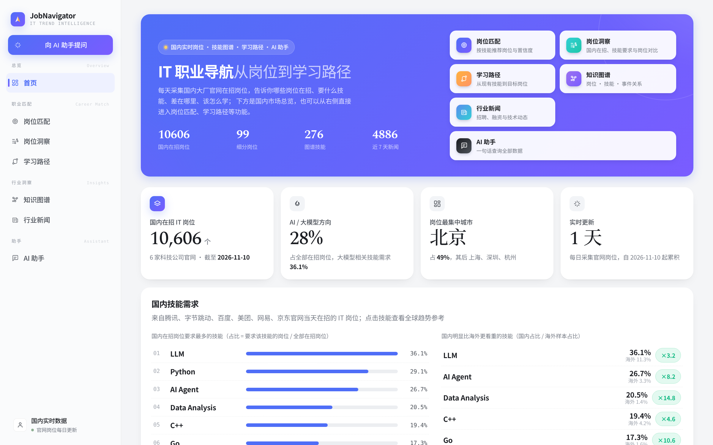
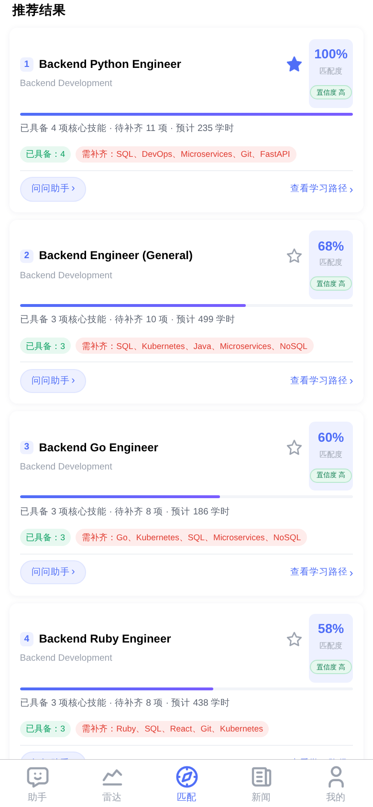

# JobNavigator-IT

面向国内 IT 求职者的职业导航应用（网页 + 微信小程序）。每天采集 49 家公司官网在招的 IT 岗位（腾讯/字节/百度/美团/网易/京东 6 家大厂 + 阿里系 15 个站点 + 小米/蔚来/小鹏/得物/面壁智能/沐瞳/度小满等 28 家科技消费公司），并从国聘平台（央企国企）与中国公共招聘网（人社部，覆盖全国中小企业）聚合 IT 岗位（含月薪与完整 JD），回答四个问题：**哪些岗位在招、要什么技能、我差在哪里、该怎么学**。海外 12.9 万条 JD 样本、海外公司招聘与裁员信号作为国际参考。

## 功能

| 功能 | 说明 |
|---|---|
| 国内市场看板 | 在招岗位数、公司与城市分布、岗位方向、国内技能需求 Top、国内比海外更看重的技能 |
| 岗位洞察与对比 | 单个岗位的国内在招数、主要公司/城市、技能要求、经验要求、官网真实岗位直达；最多 4 个岗位并排对比 |
| 岗位匹配 | 输入技能/简历，语义召回 + LTR 排序 + 分数校准，给出推荐岗位、技能缺口与置信度 |
| 学习路径 | 技能先修图 + 拓扑约束规划，2006 条学习资源（162 门含章节） |
| 知识图谱 | 岗位—技能—事件关系图，可拖动、缩放 |
| 行业新闻 | 14 个中英文来源，每 3 小时更新 |
| AI 助手 | DeepSeek 工具调用，优先使用国内实时数据回答 |
| 个人中心 | 收藏、路径存档、浏览历史 |

## 核心指标（2026-11-18，每日自动更新）

| 指标 | 数值 | 说明 |
|---|---|---|
| 国内在招 IT 岗位 | **24,395 个** | 51 个采集源：49 家公司官网 + 国聘 + 中国公共招聘网，每日更新 |
| 全球 JD 样本 | 12.99 万条 | 8 个公开数据集融合，37 个月 |
| 岗位 / 技能 / 学习资源 | 99 岗 · 630 技能 · 2006 条 | 岗位画像每月重建 |
| 匹配 Hit@1 / NDCG@5 | **1.000** / 0.774 | 58 例评估集，本地 LTR 零 API 调用（`reports/eval/ltr_eval.json`） |
| 趋势预测中位 MAPE | 0.307 | Chronos-Bolt 逐技能回测上岗，较 Holt 低 17.7% |
| 测试 | 159 passed | 单元 + 接口契约 |

## 界面预览

**网页端**




**微信小程序**

| 助手 | 雷达 | 匹配 | 我的 |
|---|---|---|---|
|  |  |  |  |

## 目录

```text
app/                FastAPI 后端（api/ 接口，services/ 业务与模型）
frontend/           网页端（React + TypeScript + Vite）
miniprogram/        微信小程序（Taro 4 + React）
pipelines/
  cn_jobs/          国内官网岗位采集与国内市场聚合（每日）
  news/             新闻采集（每 3 小时）
  extract/ taxonomy/ graph/ report/ trend/ trend_v2/ evidence_v2/ foundation/
                    全球 JD 融合、技能词表、岗位画像、先修图、资源库、趋势面板（每月）
  monthly_update.py 月度全链路更新
experiments/        匹配、路径、排序、时序模型的评估与调参脚本
data/gold/          服务直接读取的数据产物；data/cn_jobs/ 国内岗位快照与进出记录
models/             LTR 排序模型等本地模型
reports/eval/       评估结果（JSON/Markdown）
docs/               架构与模块说明、数据与更新机制、2026-11 整理记录
infra/              数据库迁移、Docker、cron 配置
scripts/            启动脚本
```

## 快速开始

```bash
pip install -r requirements.txt
cp .env.example .env                        # 填写 JOBNAV_POSTGRES_DSN、JOBNAV_LLM_API_KEY 等
docker compose up -d postgres               # 或使用已有 PostgreSQL 16 + pgvector
python -m pipelines.cn_jobs.collect         # 采集国内岗位（需外网）
python -m pipelines.cn_jobs.build_market    # 生成国内市场数据
bash scripts/start_api.sh                   # 后端 http://127.0.0.1:8000/docs
cd frontend && npm install && npm run build && npm run preview     # 网页 http://127.0.0.1:5173
cd miniprogram && npm install && npm run build:weapp               # 用微信开发者工具导入 miniprogram/
```

`JOBNAV_PATH_PLANNER=v4`、`JOBNAV_RANKER=ltr` 为默认配置（`scripts/start_api.sh` 已设置）。

## 主要接口

| 接口 | 作用 |
|---|---|
| `GET /v1/market/overview` | 国内市场总览 |
| `GET /v1/market/roles`、`/v1/market/roles/{role}` | 岗位列表 / 单岗位国内画像 + 海外参考 |
| `GET /v1/market/compare?roles=a,b` | 岗位对比 |
| `GET /v1/market/companies?region=cn\|global` | 公司在招（国内 / 海外参考） |
| `POST /v1/jobs/recommend`、`POST /v1/careers/rank` | 岗位匹配 |
| `POST /v1/paths/generate` | 学习路径 |
| `GET /v1/graph` | 知识图谱 |
| `GET /v1/news` | 行业新闻 |
| `POST /v1/agent/chat` | AI 助手 |
| `/v1/me/*` | 个人中心 |

## 文档

- **[项目总览与答辩手册](reports/项目总览与答辩手册.md)**：零基础可读的全项目讲解，所有术语带通俗解释，附答辩 Q&A
- **[答辩手册·详细版](reports/项目总览与答辩手册_详细版.md)**：每个模块的输入/输出/算法/参数/评估/代码位置，Q&A 扩展版
- [架构与模块说明](docs/架构与模块说明.md)：链路、模型、方法、质量现状
- [数据与更新机制](docs/数据与更新机制.md)：数据来源、定时任务、常用命令
- [2026-11 整理记录](docs/2026-11整理记录.md)：本轮改动、清理清单、遗留问题
- [答辩问题准备](reports/答辩问题准备.md)：评委高频问题与标准回答
- [迁移与上线指南](docs/迁移与上线指南.md)：迁移到本地（无 GPU）的步骤、网页/小程序上线流程与费用

## 测试

```bash
python -m pytest -q          # 159 passed, 1 skipped
```
