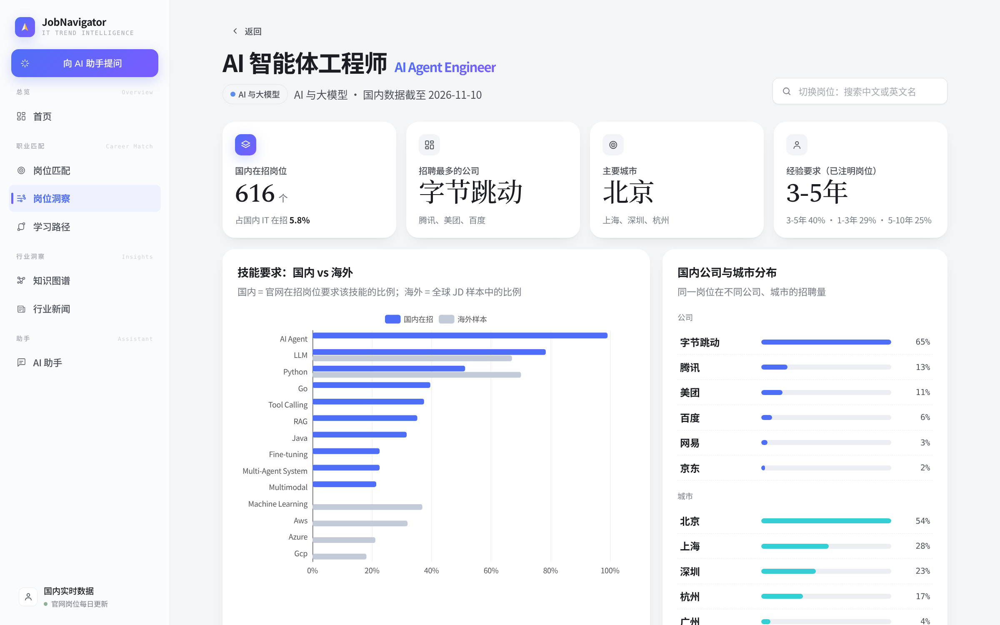
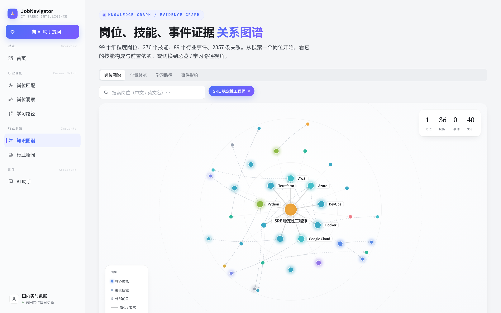
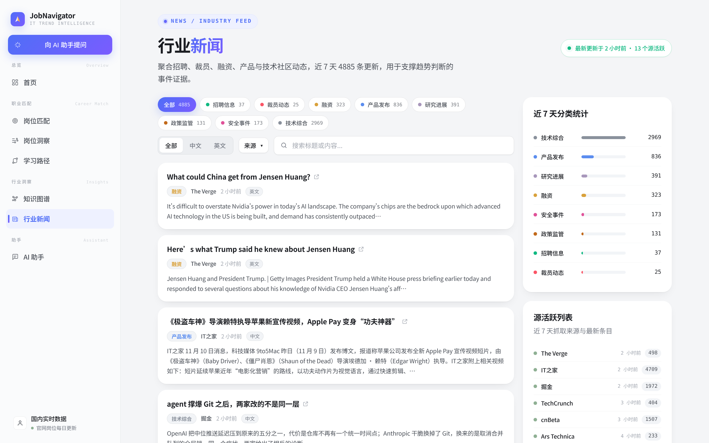
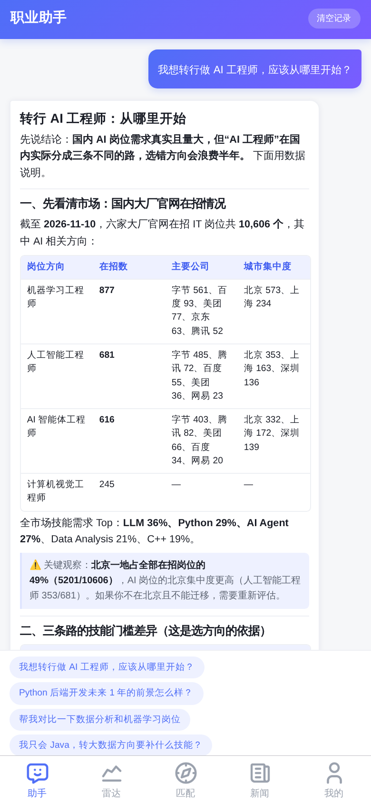
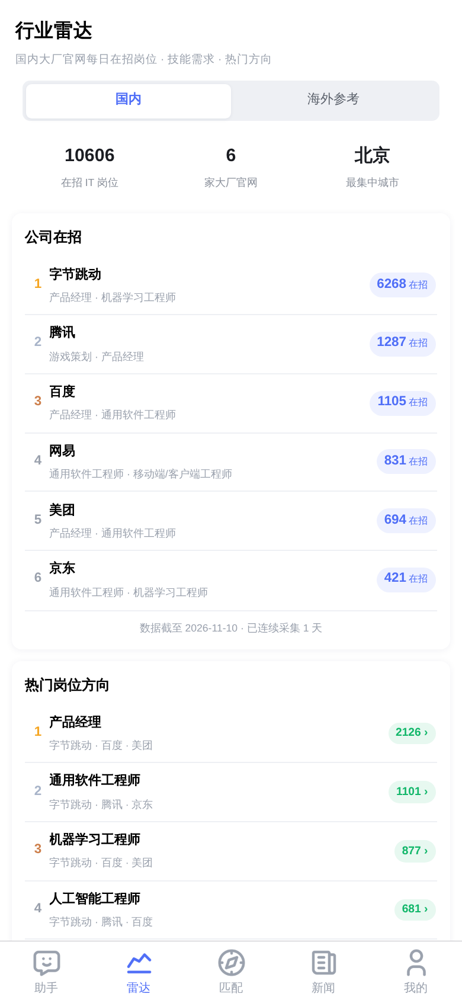
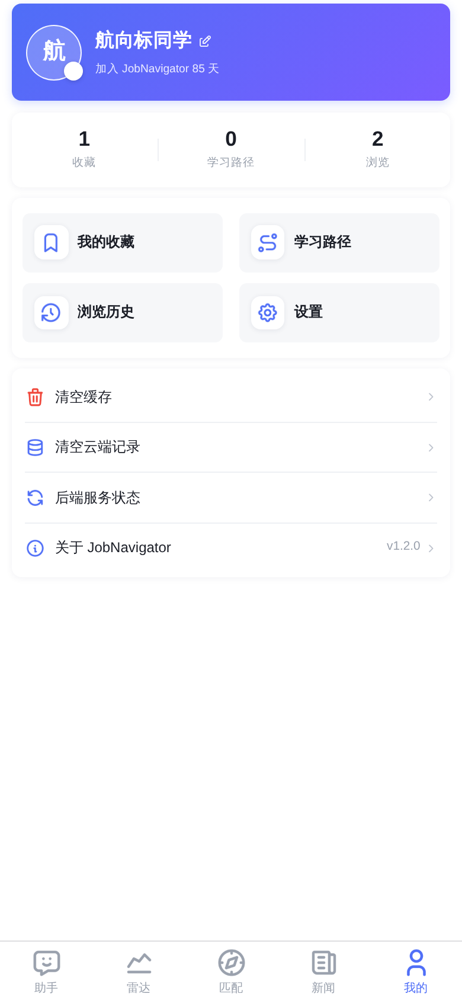
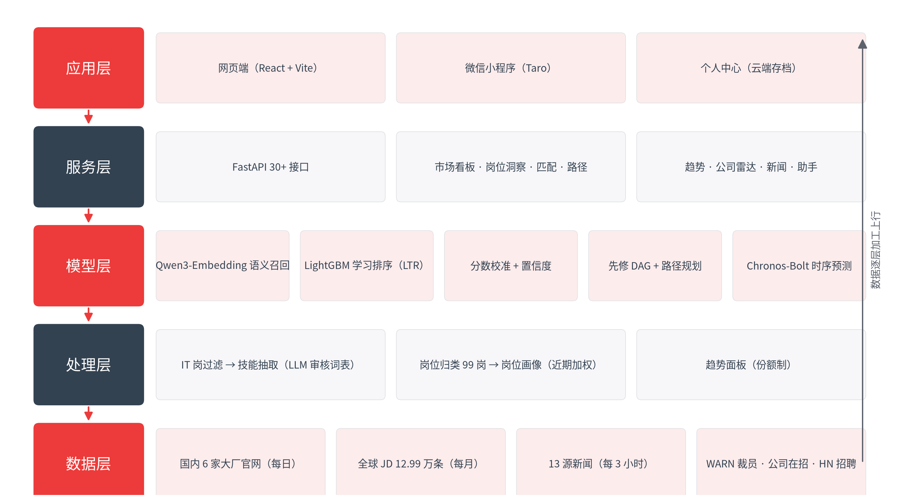

<div align="center">

# JobNavigator-IT

**面向IT岗位的职业导航与行业洞察 Agent 平台**

每天从 **51 个来源**采集国内在招 IT 岗位，回答四个问题：
**哪些岗位在招 · 要什么技能 · 我差在哪里 · 该怎么学**

[](#-界面预览)
[](#-数据说明)
[](tests/)

[功能特性](#-功能特性) · [界面预览](#-界面预览) · [技术架构](#-技术架构) · [快速开始](#-快速开始) · [数据说明](#-数据说明) · [评估指标](#-评估指标) · [文档](#-文档)

</div>

---

## ✨ 功能特性

| 模块 | 说明 |
|---|---|
| 📊 **国内市场看板** | 在招岗位数、公司与城市分布、岗位方向、技能需求 Top、国内 vs 海外技能对照 |
| 🔍 **岗位洞察与对比** | 单岗位在招数、主要公司/城市、技能与经验要求、官网真实岗位直达；最多 4 岗并排对比 |
| 🎯 **岗位匹配** | 输入技能/简历 → 语义召回 + LTR 学习排序 + 分数校准，输出推荐岗位、技能缺口与三档置信度 |
| 🗺️ **学习路径** | 技能先修图（443 条边）+ ZPD 最近发展区规划，挂载 2053 条学习资源（162 门含章节） |
| 🕸️ **知识图谱** | 岗位—技能—事件关系图，可拖动探索 |
| 📈 **行业趋势与公司雷达** | 技能趋势预测（Chronos-Bolt 逐技能回测选模）、公司扩张/收缩榜、WARN 裁员信号 |
| 📰 **行业新闻** | 14 个中英文来源，每 3 小时更新 |
| 🤖 **AI 职业助手** | DeepSeek 函数调用，14 个工具全部落在本地实时数据，回答强制标注数据口径与日期 |
| 👤 **个人中心** | 收藏、路径存档、浏览历史，双端云端同步 |

## 🖼️ 界面预览

<details open><summary><b>网页端</b></summary>
<br>
 
 
</details>

<details><summary><b>微信小程序</b></summary>
<br>
<div align="center">
   
</div>
</details>

## 🏗️ 技术架构

<div align="center">

</div>

**五层流水线**：数据逐层加工上行，线上只读本地产物——快、省、可解释。

```
数据层   51 个采集源（49 家公司官网 + 国聘 + 中国公共招聘网）· 全球 JD 12.99 万条 · 14 源新闻
  ↓ 每日 / 每 3 小时 / 每月
处理层   IT 岗过滤（含硬排除清单）→ 技能抽取（词表 321 含硬件簇 + LLM 审核）→ 岗位归类（规则 + Qwen3 语义兜底）→ 岗位画像（近期加权）
  ↓
模型层   Qwen3-Embedding-4B 语义召回 → LightGBM LambdaRank 学习排序 → p5/p95 分数校准
         技能先修 DAG + ZPD 路径规划 · Chronos-Bolt / Holt 逐技能回测选模
  ↓
服务层   FastAPI 30+ 接口（市场 / 洞察 / 匹配 / 路径 / 趋势 / 雷达 / 新闻 / 助手 / 个人中心）
  ↓
应用层   网页（React + Vite）· 微信小程序（Taro 4 + React）
```

**核心模型选型原则**：LLM 只用于离线标注/审核与可选增强，线上关键路径全部本地模型——
匹配排序用 DeepSeek 蒸馏的 LightGBM（Hit@1 1.000，<1s，零 API 成本）；
趋势预测逐技能回测，Chronos 只在严格更优的 111/207 个技能上岗。

## 🚀 快速开始

**环境要求**：Python 3.11 · Node 18+ · PostgreSQL 16 + pgvector · （可选）GPU

```bash
# 1. 安装依赖
pip install -r requirements.txt
cp .env.example .env                     # 填写 JOBNAV_POSTGRES_DSN、JOBNAV_LLM_API_KEY 等

# 2. 数据库
docker compose up -d postgres            # 或使用已有 PostgreSQL + pgvector

# 3. 数据（二选一）
#   a. 使用仓库自带的最新数据产物（data/gold/，开箱即用）——直接进入第 4 步
#   b. 重新采集：python -m pipelines.cn_jobs.collect && python -m pipelines.cn_jobs.build_market

# 4. 启动服务
bash scripts/start_api.sh                # 后端 http://127.0.0.1:8000/docs
cd frontend && npm install && npm run build && npm run preview   # 网页 http://127.0.0.1:5173
cd miniprogram && npm install && npm run build:weapp             # 微信开发者工具导入 miniprogram/
```

> **无显卡也能跑**：向量编码模型 CPU 单次 2~5 秒；追求速度可换 Qwen3-Embedding-0.6B。

## 📊 数据说明

| 数据 | 来源 | 规模 | 更新 |
|---|---|---|---|
| 国内在招岗位 | 49 家公司官网公开接口（腾讯/字节/百度/阿里系/小米/蔚来…）+ 国聘平台（央企国企）+ 中国公共招聘网（人社部，中小企业） | **24,000+ 个 IT 岗位** | **每日** |
| 全球 JD 样本 | 8 个公开招聘数据集融合（海外为主） | 12.99 万条 · 37 个月 | 每月 |
| 行业新闻 | IT之家 / InfoQ / 36氪 / HackerNews / TechCrunch 等 14 源 | 2.3 万+ 条 | 每 3 小时 |
| 学习资源 | Coursera / B 站 / GitHub / 官方文档 | 2053 条（162 门含章节） | 按需 |
| 海外信号 | WARN 裁员备案 · 25 家公司在招 · HN 招聘帖 | 1748 条备案 | 每月 |

- **岗位进出记录**：每个岗位记录首次出现/最后出现日期，单日快照累积成真实时间序列——国内招聘趋势是我们自己测出来的
- **数据诚实**：官网不公开的薪资不展示、不编造；聚合平台岗位按真实雇主归集；海外数据单独标注口径，不与国内混算
- 详细机制见 [数据与更新机制](docs/数据与更新机制.md)

## 📈 评估指标

| 模块 | 指标 | 结果 | 报告 |
|---|---|---|---|
| 岗位匹配 | Hit@1 / NDCG@5（58 例） | **1.000** / 0.774 | [ltr_eval](reports/eval/ltr_eval.json) |
| 排序蒸馏 | 5 折交叉验证 NDCG@5 | 0.937 | [ltr_training](reports/eval/ltr_training_v1.json) |
| 分数校准 | 展示区分度 / 排序不变性 | ×2.9 / 逐位一致 | [calibration_eval](reports/eval/matching_v5_calibration_eval.json) |
| 学习路径 | 个性化一致性 τ（v3 → v4） | 0.001 → **0.343** | [path_eval](reports/eval/path_v4_eval.json) |
| 趋势预测 | 中位 MAPE（Chronos vs Holt） | **0.307**（-17.7%） | [chronos_eval](reports/eval/chronos_vs_holt_eval.json) |
| 技能抽取 | 全球 JD 覆盖率（全量 12.99 万行） | 86.8% | [vocab_report](reports/eval/skill_vocab_v4_report.json) |
| 工程质量 | 单元 + 接口契约测试 | **159 passed** | [tests/](tests/) |

所有评估脚本在 [`experiments/`](experiments/) 下可复跑。

## 📁 项目结构

```text
app/                FastAPI 后端（api/ 接口 · services/ 业务与模型）
frontend/           网页端（React + TypeScript + Vite）
miniprogram/        微信小程序（Taro 4 + React）
pipelines/
  cn_jobs/          国内岗位采集与市场聚合（每日）
  news/             新闻采集（每 3 小时）
  extract/ taxonomy/ graph/ trend/ trend_v2/ foundation/ report/ evidence_v2/
                    全球 JD 融合 · 技能词表 · 岗位画像 · 先修图 · 趋势面板（每月）
  monthly_update.py 月度全链路更新（14 步，cron 驱动）
experiments/        评估与调参脚本（匹配 / 排序 / 校准 / 路径 / 时序）
data/gold/          运行时数据产物（每日/每月自动更新）
models/             本地模型（LTR 排序等）
reports/eval/       评估报告（JSON，可复现）
docs/               架构说明 · 数据与更新机制
infra/              数据库迁移 · Docker · cron 配置
```

## 📚 文档

| 文档 | 内容 |
|---|---|
| [架构与模块说明](docs/架构与模块说明.md) | 五层链路、各模块方法、质量现状 |
| [数据与更新机制](docs/数据与更新机制.md) | 数据来源明细、定时任务、常用命令、如何新增采集源 |
| [2026-11 整理记录](docs/2026-11整理记录.md) | 近期改动、技术决策与遗留问题 |

## 🧪 测试

```bash
python -m pytest -q          # 159 passed, 1 skipped
```

## 🗺️ 路线图

- [x] 国内 51 源实时采集与市场看板
- [x] LTR 蒸馏排序 + 分数校准 + 置信度
- [x] 学习路径 v4（先修 DAG + ZPD）
- [x] 微信小程序五 tab 上线
- [ ] 继续扩展公司覆盖（反爬站点合规方案评估中）
- [ ] 校内试点，用真实用户行为数据迭代排序模型
- [ ] 申报软件著作权

---

<div align="center">
华东师范大学 · 大学生创新创业项目 · 2026
</div>
